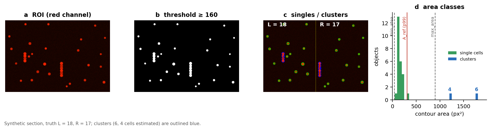
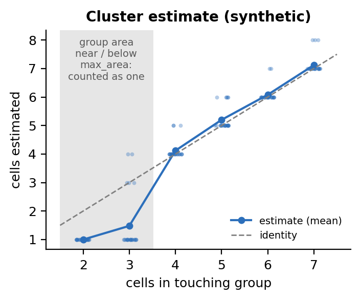

<div align="center">

# EasyCellCounting

**Fast, reproducible counting of fluorescent cells on the left and right side of a region of interest**

[](https://github.com/ack41704/EasyCellCounting/actions/workflows/tests.yml)

[](LICENSE)

</div>



EasyCellCounting counts bright fluorescent cells (for example tdTomato-expressing neurons)
in microscopy images of tissue sections. You draw one region of interest (ROI) per image
with the keyboard and mouse, then every ROI is counted automatically at full resolution.
Cells are reported separately for the **left and right half** of the ROI, so ipsilateral
and contralateral counts come out of one pass. Results go into a tidy CSV and an Excel
workbook with one row per animal.

It was first written to count tdTomato-labelled neurons in spinal cord and brain
sections. It works on any image where the cells are brighter than the background in
one colour channel.

- **Two steps.** Drawing ROIs is interactive (about 2 s per image). Counting is a batch step with no user input.
- **Reproducible.** ROIs, rotation and per-image thresholds are saved to `rois.csv`. You can recount a whole dataset with new parameters without drawing anything again, and readers can rerun your exact analysis.
- **Transparent.** Each count comes with an annotated image (green = single cell, blue = cluster with its estimated cell number) and the binary mask.
- **Handles touching cells.** Each clump of touching cells is converted to a number of cells using the single-cell area measured in the same ROI.
- **Faithful to the original script.** On the same input, the counts match the 2025 script exactly (that equivalence is a test in `tests/`), with three documented bug fixes.

---

## Contents
[Installation](#installation) · [Quick start](#quick-start) · [Interactive keys](#interactive-roi-selection) ·
[Method](#method) · [Parameters](#parameters) · [Outputs](#outputs) · [File names](#file-names-animals-sections-regions) ·
[Validation](#validation) · [Changes from the original script](#changes-from-the-original-script) ·
[Methods text](#suggested-methods-text) · [Citation](#citation)

## Installation

You need Python 3.9 or newer.

```bash
git clone https://github.com/ack41704/EasyCellCounting.git
cd EasyCellCounting
pip install -e .            # add ".[test,figures]" for the tests and figure scripts
```

This installs the `easycellcount` command and the `easycellcounting` Python package.
The only dependencies are NumPy, pandas, OpenCV and openpyxl.

## Quick start

**1. Try it on synthetic data** (no images needed):

```bash
easycellcount demo --out easycellcount_demo
```

This makes six synthetic sections with known cell numbers, counts them, and prints found
vs. true counts.

**2. Draw ROIs on your images**, one per image. Each ROI is saved as soon as you draw it,
so you can stop at any time and resume later:

```bash
easycellcount select path/to/images --rois rois.csv
```

**3. Count**:

```bash
easycellcount count path/to/images --rois rois.csv --out results/
```

Or do both steps in one go with `easycellcount run path/to/images --rois rois.csv --out results/`.
Without ROIs, `count` uses the whole image. `--box x,y,w,h` applies the same box to
every image.

**From Python:**

```python
from easycellcounting import CountParams, count_cells, count_folder
from easycellcounting.io import load_image

# one image (or ROI) -> counts
res = count_cells(load_image("section_s1.tif"), CountParams(threshold=160))
print(res.left, res.right, res.n_clusters)

# a folder + saved ROIs -> tidy table + Excel workbook + annotated crops
df = count_folder("path/to/images", rois="rois.csv", out_dir="results")
```

## Interactive ROI selection

Each image is shown at screen size. Full-resolution TIFFs can be used directly; previews
are made on the fly. To reuse a folder of down-scaled copies as in the original workflow,
pass `--preview-dir`. Press a **preset key**, drag a box, then press **SPACE/ENTER**.

| Key | Action | | Key | Action |
|:---:|---|---|:---:|---|
| `t` | default threshold (160) | | `w` / `e` | rotate +7° / −7° |
| `v` | threshold 200 | | `o` | rotate 180° |
| `p` | threshold 250 | | `q` | **check**: type a threshold, draw a box, see the annotated count |
| `i` | typed threshold, no cluster size cap | | `u` | undo (go back one image) |
| `s` | skip image | | `m` | draw this ROI, then stop |
| `Esc` | stop now | | | |

The ROI file records the rotation and the threshold chosen for each image. Rotation lets
you line the anatomical midline up with the vertical midline of the box. Run
`easycellcount select` again to continue where you stopped; `--restart` starts over.

## Method

For each ROI (full resolution, after rotation):

1. **Threshold.** A pixel is signal when its value in the chosen channel (default red)
   is at least the threshold *T* (8-bit scale; 16-bit images are scaled by 1/256, the
   way OpenCV reads them).
2. **Segment.** Outer contours of the binary mask are found (`cv2.findContours`,
   `RETR_EXTERNAL`). Each contour is one object with area *A* in px².
3. **Classify** by area:

   | object | rule (defaults) |
   |---|---|
   | single cell | *A*<sub>min</sub> < *A* < *A*<sub>max</sub> (40 < *A* < 900 px²) |
   | cluster | *A*<sub>max</sub> ≤ *A* < *A*<sub>cluster</sub> (900 ≤ *A* < 10 000 px²) |
   | ignored | debris below *A*<sub>min</sub>, artefacts above *A*<sub>cluster</sub> |

4. **Clusters → cells.** The reference single-cell area is the 99th percentile of the
   single-cell areas in the same ROI, $A_\mathrm{ref} = P_{99}(\{A_i\}_\mathrm{single})$.
   A cluster of area *A* counts as

   $$n = \left\lfloor \frac{A}{A_\mathrm{ref}} \right\rfloor + 1 .$$

   Clusters are only converted when the ROI has at least 4 single cells to estimate
   *A*<sub>ref</sub>. Otherwise they are left out and the annotated image shows none.
   `--cluster-rule round` uses $\max(1, \mathrm{round}(A/A_\mathrm{ref}))$ instead.
5. **Left / right.** Each object is assigned to the half of the ROI that contains the
   centre of its minimum enclosing circle. The reported count is single cells plus
   cluster cells on each side.

The area limits are in **pixels**, so they depend on magnification and binning. Set
*A*<sub>max</sub> just above the largest single cell in your images. Use the `q` check
key, or the annotated images, on a few sections before a full run.

## Parameters

| option | default | meaning |
|---|---|---|
| `--threshold` | 160 | channel value counted as signal (0–255) |
| `--min-area` | 40 | smallest single cell (px²) |
| `--max-area` | 900 | largest single cell (px²); larger objects are clusters |
| `--cluster-max-area` | 10 000 | largest object treated as a cluster (px²) |
| `--channel` | red | `red`, `green`, `blue` or `gray` |
| `--cluster-rule` | floor_plus_one | `floor_plus_one` (original) or `round` |
| `--smooth` | off | 3×3 morphological opening + closing of the mask |
| `--animal-regex` | `\d+\.\d+` | how to find the animal tag in file names |
| `--animal-slice` | – | fixed character slice instead, e.g. `6:13` (as in the original) |
| `--ignore-roi-params` | off | use the command-line threshold for every image instead of each ROI's preset |

In Python, the same settings are fields of `CountParams`, plus `min_singles_for_clusters`
(default 4) and `reference_percentile` (default 99).

## Outputs

`results/` contains:

| file | content |
|---|---|
| `cell_counts.csv` | one row per image (see the columns below) |
| `cell_counts.xlsx` | **Left-Right counts** sheet: left, right and total tables with one row per animal and one column per section, cells coloured by region code, and a colour legend. **Per image** sheet: the CSV. **Parameters** sheet: software version and settings |
| `annotated/*.png` | ROI with single cells (green), clusters (blue, with estimated cell number), the midline and the counts |
| `masks/*.png` | binary threshold mask of each ROI |

CSV columns: `file, animal, section, section_label, region, left, right, total,
single_left, single_right, cluster_cells_left, cluster_cells_right, n_clusters,
reference_area_px, n_objects, roi_x, roi_y, roi_width, roi_height, rotation_deg,
threshold, min_area, max_area, cluster_max_area, channel, preset`.

## File names: animals, sections, regions

The workbook groups images by animal. Images are sorted *naturally* (`s2` before `s10`):

- **animal**: the first match of `--animal-regex`. The default `\d+\.\d+` gives `3730.4`
  for `Zymo6 3730.4 1-12_s1.tif`. Use a capture group for other schemes, e.g.
  `--animal-regex "M(\d+)"`.
- **section**: the position of the image within its animal (the workbook column). The
  `_s<n>` tag at the end of the name is kept as `section_label`.
- **region**: an optional code `A1`–`C4` anywhere in the name, as a separate token
  (`CA1` does not match). It colours the workbook cells with the same colour code as
  the original script.

## Validation

The test suite (`pytest`, 56 tests) checks every component. It also checks that the
counts match a line-by-line port of the original script on synthetic sections (24
image × threshold combinations).

The synthetic benchmark (`python examples/benchmark_synthetic.py`) shows where the
cluster rule holds. Each image has 15–25 isolated cells per side (radius 7–11 px), plus
one touching group of *k* cells. There are 25 images per *k*:

<table><tr><td>

| cells in group | isolated cells exact | mean estimate | exact | within ±1 |
|:-:|:-:|:-:|:-:|:-:|
| 2 | 100 % | 1.00 | 0 % | 100 % |
| 3 | 100 % | 1.48 | 12 % | 20 % |
| 4 | 100 % | 4.12 | 88 % | 100 % |
| 5 | 100 % | 5.20 | 80 % | 100 % |
| 6 | 100 % | 6.08 | 92 % | 100 % |
| 7 | 100 % | 7.12 | 88 % | 100 % |

</td><td>



</td></tr></table>

What the benchmark shows:

- Isolated cells are counted exactly.
- Groups whose area exceeds *A*<sub>max</sub> are estimated to within one cell.
- Doublets, and groups near *A*<sub>max</sub>, are counted as **one** cell. They also
  inflate *A*<sub>ref</sub>.

So set *A*<sub>max</sub> from your own single-cell sizes. On real tissue, report
agreement with blinded manual counts on a subset of sections; synthetic data only shows
that the implementation is correct.

To regenerate the figures: `python docs/make_figures.py`.

## Changes from the original script

The original 2025 script is kept unchanged in [`legacy/EasyCellCounting.py`](legacy/EasyCellCounting.py)
for exact reproduction of earlier analyses. Its counting rules are the package defaults.
Behaviour differs only where the original had a bug:

| | original | now | effect |
|---|---|---|---|
| threshold | `r in range(T, 255)` excluded value 255 | `r >= T` | saturated cell cores were background, so fully saturated cells were missed |
| ROI scaling | x scaled by the height ratio, y by the width ratio | x by width, y by height | only matters when the preview and full image have different aspect ratios |
| file order | plain string sort (`s10` before `s2`) | natural sort | workbook section columns follow section order |
| `q` check | added an extra entry to `cluster_max`, shifting later images' cluster caps | no shared state | only after `q` was used together with `i` |
| objects on the midline / at exactly *A*<sub>max</sub> | dropped | counted (right side / cluster) | rare |
| rotation | applied step by step to the image (interpolated each time) | one rotation by the total angle | slightly sharper rotated images |

New features include the following:

- ROI files, with resume and recount.
- Command line and Python API.
- Annotated images and masks.
- A template-free Excel workbook.
- Grayscale, green or blue channels.
- An optional smoothing step and the `round` cluster rule (from later notebook versions).
- `s` to skip an image and `Esc` to stop.

## Suggested methods text

> Fluorescent cells were counted with EasyCellCounting v1.0.0 (Khambete, https://github.com/ack41704/EasyCellCounting).
> For each section a rectangular region of interest was drawn, with the midline aligned to
> the vertical centre line of the box. Pixels with red-channel intensity ≥ *T* (8-bit) were
> segmented into connected objects (outer contours, OpenCV). Objects of 40–900 px² were
> counted as single cells. Larger objects (≤ 10 000 px²) were counted as
> ⌊*A*/*A*<sub>ref</sub>⌋ + 1 cells, where *A*<sub>ref</sub> is the 99th percentile of
> single-cell areas in the same region. Cells were assigned to the left or right half of the
> region by the centre of their minimum enclosing circle. Counts were checked against
> blinded manual counts on *n* sections (…).

Adjust the thresholds and areas to the values you used. They are recorded in
`cell_counts.xlsx` → *Parameters* and in `rois.csv`.

## Repository layout

```
src/easycellcounting/
  counting.py      threshold, segmentation, area classes, cluster rule, left/right split
  roi.py           ROI geometry, rotation, preview/full-resolution scaling, rois.csv
  interactive.py   OpenCV ROI selection (keys above)
  pipeline.py      batch counting of a folder
  report.py        CSV and Excel output, animal / section / region parsing
  synthetic.py     synthetic sections with known counts
  cli.py           `easycellcount` command
tests/             pytest suite, including equivalence with the original script
examples/          synthetic benchmark
docs/              figure script and figures
legacy/            the original 2025 script, unchanged
```

## Citation

If you use EasyCellCounting, please cite it. GitHub's **Cite this repository** button
uses [`CITATION.cff`](CITATION.cff):

> Khambete, A. *EasyCellCounting: fast, reproducible counting of fluorescent cells in microscopy images* (v1.0.0). https://github.com/ack41704/EasyCellCounting

## License

[MIT](LICENSE) © Amav Khambete
